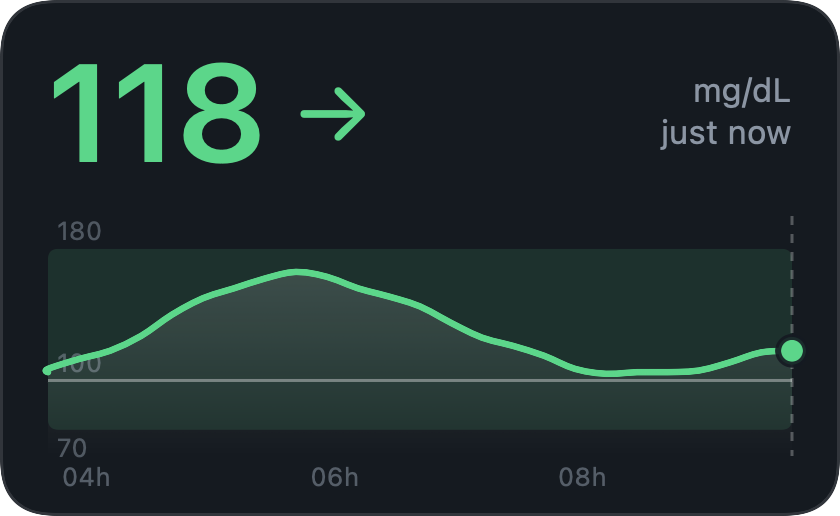
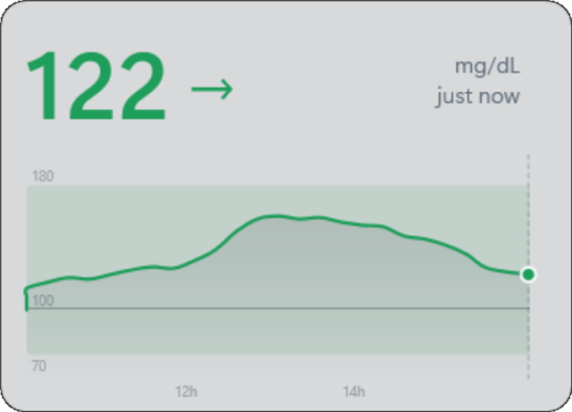
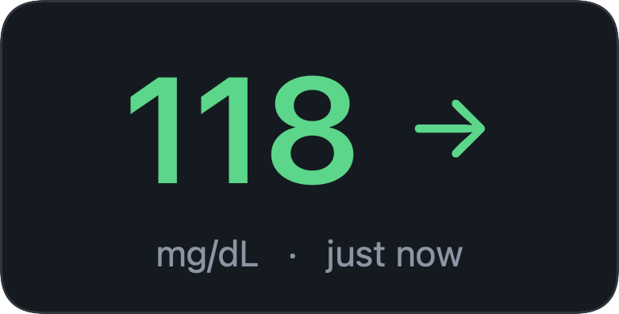
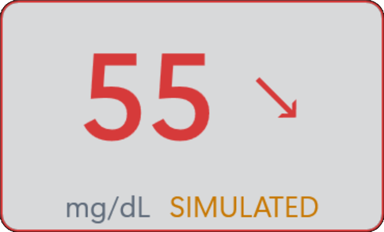
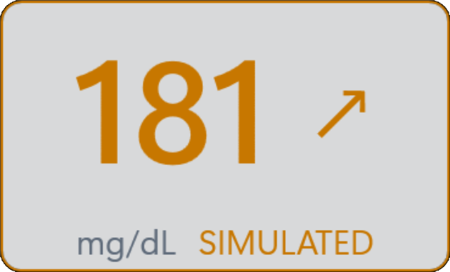
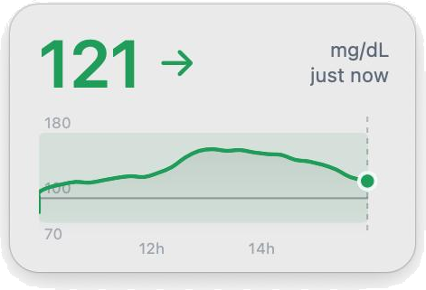
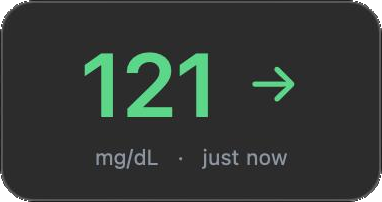
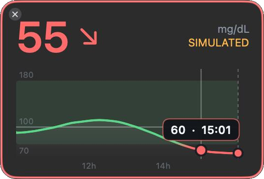
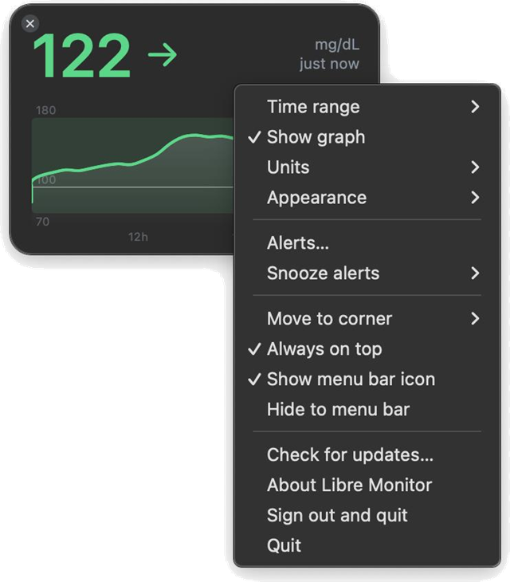

<div align="center">


# Libre Monitor

**Your FreeStyle Libre glucose, always visible on your desktop.**
A small, read-only widget for Windows and macOS.

[](https://github.com/bsalgueiro/libre-monitor/releases/latest)
[](LICENSE)
[](LICENSE-DOCS.md)


[Website](https://bsalgueiro.github.io/libre-monitor/) ·
[Download](https://github.com/bsalgueiro/libre-monitor/releases/latest) ·
[Get started](#getting-started) ·
[Alerts](#alerts) ·
[Troubleshooting](#if-the-widget-stops-updating) ·
[For developers](#for-developers)

<br>


&nbsp;


</div>

> **Not a medical device. Do not make treatment decisions from this app.**
> A free hobby project, not made for money. Independent, not affiliated with or endorsed by Abbott.

## How it works

The phone app reads the sensor and uploads to LibreView. This project does **not** talk to the sensor. It signs in to the
unofficial LibreLinkUp follower service and only reads what the phone has already uploaded.

```
Sensor  -->  LibreLink (phone)  -->  LibreView cloud  -->  Libre Monitor (your desktop)
```

**Contents:** [For users](#for-users) · [For developers](#for-developers) · [License](#license) · [Trademarks](#trademarks-and-disclaimer)

---
# For users

Everything you need to install and use the widget. No programming knowledge required.

## What it does



- Borderless, always-on-top corner widget: current value, trend arrow and a smooth graph with the 70-180 mg/dL band and a 100 reference line.
- Hover the graph for the value and time of any reading.
- The graph can be hidden. The number, arrow, unit and last-update time then scale up to fill the widget, whatever size you
  make it. Each mode remembers its own size, so turning the graph back on restores the earlier layout.
- 3, 6 or 12 hour range, mg/dL or mmol/L, and a light, dark or follow-the-system theme.
- A tray icon (Windows) or menu bar item (Mac) showing the current value on a coloured tile.
- Optional low and high [alerts](#alerts) with your own limits: a system notification, a sound and a coloured widget border, with reminders and snooze.
- Your follower login is stored encrypted for your Windows user only, or in your Mac's Keychain. It is never shown or sent
  anywhere except to LibreView.
- It only reads data. It never changes anything in your account.
- It does **not** keep your glucose history. It shows what LibreView provides at the moment, and nothing about your
  readings is saved on your PC. For history, reports and sharing, use LibreView.

The colours for low, in range and high are for display only. They are not alarms.

<br clear="all">

<div align="center">

&nbsp;

<br>
<sub>The border turns red or amber while a reading is outside your alert limits (these are simulated readings).</sub>
</div>

## Screenshots

<div align="center">

&nbsp;

&nbsp;

<br><br>

</div>

## Getting started

You need Windows 10 or 11 (64-bit), or a Mac with macOS 13 or newer (Apple Silicon or Intel). There is nothing to install
and no need to build anything: you download one file and run it.

1. In the LibreLink phone app open **Connected apps > LibreLinkUp** and invite a second email address.
2. Install the official LibreLinkUp app on a phone and create the account there with that email, then accept the
   invitation. There is no website sign-up (see [www.librelinkup.com](https://www.librelinkup.com)). This also clears the
   terms and email verification that the sign-in needs.
3. Download from the [latest release](https://github.com/bsalgueiro/libre-monitor/releases/latest) (under *Assets*):
   - **Windows:** `LibreMonitor-win-x64.exe`
   - **Mac:** `LibreMonitor-mac.zip`
4. Start it and sign in with the **follower** account, not your main one.
   - **Windows:** run the exe. If Windows shows a blue warning, see [first-open warnings](#first-open-warnings).
   - **Mac:** unzip, drag **LibreMonitor.app** into Applications and open it. macOS will warn about it the first time, see
     [first-open warnings](#first-open-warnings). The app has no Dock icon: look for the widget and the menu bar item.

Optional: to check the download is intact, compare its SHA-256 with the line in `SHA256SUMS.txt` from the same release
(Windows: `Get-FileHash .\LibreMonitor-win-x64.exe -Algorithm SHA256`; Mac: `shasum -a 256 LibreMonitor-mac.zip`).

## First-open warnings

Neither app is signed with a paid certificate, so Windows and macOS each show a warning the first time. Both are expected
and do not mean the file is damaged.

<details>
<summary><b>macOS first-open warning</b></summary>

The Mac app is not notarised by Apple (that needs a paid Apple Developer account), so the first time you open it macOS says
it cannot check it for malicious software. This is expected for an app from an independent developer; it does not mean
the file is damaged. To open it:

1. Control-click (right-click) **LibreMonitor.app** in Applications and choose **Open**, then **Open** again. On recent
   macOS versions you may instead have to open **System Settings > Privacy & Security** and click **Open Anyway**.
2. If that does not work, run this once in Terminal, then open the app normally:
   `xattr -dr com.apple.quarantine /Applications/LibreMonitor.app`

Removing the warning needs an Apple Developer ID, which costs money every year. The app is signed with a free ad-hoc
signature, which Apple Silicon Macs require in order to run it at all.

</details>

<details>
<summary><b>Windows SmartScreen warning</b></summary>

The executable is not code-signed, so the first time someone runs it, Windows SmartScreen shows a blue
**"Windows protected your PC"** window. This is expected for any unsigned program from an unknown publisher; it does not
mean the file is damaged or unsafe. To run it:

1. Click **More info**.
2. Click **Run anyway**.

Windows remembers the choice for that file. If the file came from the internet, you can also tick **Unblock** in the
file's Properties before running it.

Removing the warning needs a code-signing certificate, which costs money every year. Some antivirus tools may also
flag the single-file build.

</details>

## Using the widget

| To do this | Do this |
|---|---|
| Move it | Drag it |
| Resize it | Drag any edge or corner |
| Change the time range | Mouse wheel over the widget, or the menu |
| Hide or show the graph | Menu > Show graph (untick it for a compact widget with just the number) |
| See a reading's value and time | Hover the graph |
| Open the menu | Right-click the widget |
| Switch mg/dL and mmol/L | Menu > Units |
| Light, dark or follow Windows | Menu > Appearance |
| Set up low and high alerts | Menu > Alerts... |
| Pause alerts for a while | Menu > Snooze alerts |
| Snap to a screen corner | Menu > Move to corner |
| Hide it to the tray | Click the ✕, or Menu > Hide to tray |
| Bring it back | Click the tray icon |
| Quit | Menu > Exit, or the tray icon's menu |
| Turn the tray icon off | Menu > untick Show tray icon (the ✕ then exits instead of hiding) |
| Sign out | Menu > Sign out and exit |

Position, size and preferences are remembered.

**On a Mac** the menu is the same, with these differences: the ✕ is at the top-left of the widget (shown when you hover it)
and hides it to the menu bar, the menu bar item replaces the tray icon, and notifications appear in Notification Centre.

## Alerts

Open **Menu > Alerts...** to turn on a low alert, a high alert, or both, and set your own limits (in mg/dL or mmol/L,
whichever the widget shows). They are **off until you turn them on**. Use **Send test alert** to see what one looks like.

- **When it alerts:** once, when a reading goes below the low limit or above the high limit. The widget border also turns
  red (low) or amber (high) while the reading stays out of range.
- **Reminders:** while still out of range you can be reminded every 15, 30 or 60 minutes, or not at all.
- **No repeated alerts at the limit:** after an alert, the reading has to come back at least 5 mg/dL (about 0.3 mmol/L) inside
  the range before the next crossing counts as a new alert, so a value hovering on the line does not alert over and over.
- **Snooze:** **Menu > Snooze alerts** pauses notifications for 30 minutes, 1 hour or 2 hours. If you are still out of range
  when the snooze ends, you are alerted then.
- **Old readings are ignored:** a reading more than 10 minutes old does not trigger an alert.
- **Notifications need the tray icon** on Windows. If you turn it off, alerts still play the sound and colour the border.
  On a Mac they use macOS notifications: the first time, macOS asks for permission, and you can change it later in
  System Settings > Notifications > Libre Monitor.

**Do not rely on these alerts for safety.** They only work while this app is running, your PC is on and awake, and your
phone is uploading to LibreView. Readings can arrive minutes late, and Windows can hide notifications (for example in
Focus assist or Do not disturb). Keep your sensor's own alarms on.

## Troubleshooting

The widget shows what is wrong in the small status text next to the number:

| It says | What it means | What to do |
|---|---|---|
| **reconnecting** (amber) | A temporary problem: no internet, or LibreView is busy. | Nothing. It tries again every minute. |
| **sign-in needed** (red) | The follower email or password is no longer accepted. | Menu > Sign out and quit, start it again and sign in. |
| **service changed** (red) | LibreLinkUp is no longer answering the way this app expects, three checks in a row. Abbott may have changed or blocked the unofficial service. | Menu > **Check for updates...**. On Windows a notification tells you once, and clicking it opens the same page. |

This app relies on a service that Abbott does not publish for third parties, so it can stop working without warning. If you
are already on the newest version, the app needs a fix from its developer, so please report it on the project's page.
Your own data and your LibreLink app are not affected either way. **Menu > About** shows which version you have.

---

# For developers

Building, running from source, testing and the technical background. The repository has one folder per platform, and the
two apps are deliberate twins: the Mac logic is a hand-written Swift port of the C# logic, with the same file names and
the same tests.

```
libre-monitor/
  windows/            .NET 10 solution: src/ (Core, App, Cli), tests/, LibreMonitor.slnx
  mac/                Swift package: Sources/ (LibreMonitorKit, LibreMonitorMac), Tests/, scripts/
  docs/               the project website (GitHub Pages)
  .github/workflows/  windows.yml and mac.yml (CI), release.yml (publishes both)
```

**Developer contents:** [Windows](#windows) · [macOS](#macos) · [Releases](#publishing-a-release) ·
[Technical notes](#technical-notes)

**When you change shared behaviour** (alert rules, error classification, polling, unit conversion), change both
platforms and both test suites. `LibreMonitor.Core` and `LibreMonitorKit` should keep giving the same answers.

## Windows

The Windows app is a WPF widget on .NET 10. Everything lives in `windows/`. Building the widget needs Windows. The
`Core` library and its tests also build on a Mac or Linux with the .NET 10 SDK.

| Project | Purpose |
|---|---|
| `LibreMonitor.Core` | LibreLinkUp client (login with regional redirect, patients, graph), polling monitor, alert rules, unit conversion |
| `LibreMonitor.App` | The WPF widget: window, graph, tray icon, alerts window, DPAPI login store |
| `LibreMonitor.Cli` | Console check of the connection |
| `LibreMonitor.Core.Tests` | xUnit tests using fake HTTP responses (no network) |

### Run from source

Requires Windows and the .NET 10 SDK. Set up the follower account first (steps 1 and 2 under
[Getting started](#getting-started)), then, from the repository root:

```powershell
dotnet run --project windows/src/LibreMonitor.App
```

To only check the connection from a console (credentials from `LIBRE_EMAIL` / `LIBRE_PASSWORD`, or prompted):

```powershell
dotnet run --project windows/src/LibreMonitor.Cli
```

### Tests

```powershell
dotnet test windows/tests/LibreMonitor.Core.Tests
```

Tests use fake HTTP responses and never contact the network. The same command runs in CI (`windows.yml`) on every change under
`windows/`, together with a build of the whole solution including the WPF app.

### Developer mode

Running a Debug build with `--dev` adds a **Developer: simulate reading** entry to the widget menu. It fakes a reading for
each colour state (low, in range, high, old, none) so the display can be checked without waiting for real glucose to
change. The widget and the tray tooltip say SIMULATED while it is active.

```powershell
dotnet run --project windows/src/LibreMonitor.App -- --dev
dotnet run --project windows/src/LibreMonitor.App -- --simulate 2   # start with scenario 2 showing
```

`dotnet run` and `dotnet build` without `-c Release` make Debug builds, which are the ones that accept these flags. A
Release or published executable ignores `--dev` and `--simulate`, so it can never show a simulated value.

### Building an executable

Both builds below are Release builds. The `publish` folder is ignored by git.

**For yourself (small).** Needs the .NET 10 Desktop Runtime on the machine that runs it, which most PCs do not have.

```powershell
dotnet publish windows/src/LibreMonitor.App -c Release -o publish
```

This produces `publish\LibreMonitor.App.exe` and a few supporting files, about 0.3 MB in total.

**For sharing with other people (self-contained).** Carries its own copy of .NET, so nothing needs to be installed.

```powershell
dotnet publish windows/src/LibreMonitor.App -c Release -r win-x64 --self-contained true `
  -p:PublishSingleFile=true -p:EnableCompressionInSingleFile=true -p:IncludeNativeLibrariesForSelfExtract=true `
  -o publish
```

This produces a single `publish\LibreMonitor.App.exe` of about 72 MB for 64-bit Windows 10 or 11. It started and ran
with .NET removed from the environment, but it has not been tried on a clean machine. Because it bundles its own .NET,
it does not receive .NET security updates unless it is rebuilt and handed out again.

Whoever receives the executable will see the [SmartScreen warning](#first-open-warnings), because it is unsigned.

## macOS

The Mac app is a Swift package in `mac/`, written with AppKit and SwiftUI for macOS 13 or newer. It needs a Mac with the
Swift toolchain. The Command Line Tools are enough to build and run the app, but running the tests needs the full Xcode
app, because XCTest ships with Xcode.

| Target | Purpose |
|---|---|
| `LibreMonitorKit` | Pure logic with no UI: LibreLinkUp client, polling monitor, alert rules, models, unit conversion. The port of `LibreMonitor.Core` |
| `LibreMonitorMac` | The app: floating panel, graph, menu bar item, alerts window, Keychain login store, notifications |
| `LibreMonitorKitTests` | XCTest tests using fake HTTP responses (no network). Ports of the C# tests |

### Build and run from source

Set up the follower account first (steps 1 and 2 under [Getting started](#getting-started)). The app needs a real `.app`
bundle for notifications and its icon, so use the script rather than `swift run`:

```bash
cd mac
./scripts/make-app.sh --debug       # build/LibreMonitor.app for this Mac only
open build/LibreMonitor.app
```

The app has no Dock icon: look for the widget and the menu bar item. The build is ad-hoc signed, so macOS shows the
[first-open warning](#first-open-warnings) for a build you made yourself too.

### Tests

```bash
cd mac
swift test        # unit tests, no network; needs Xcode, not just the Command Line Tools
```

CI (`mac.yml`) runs the build, the tests and both app builds on every change under `mac/`.

### Developer mode

A Debug app accepts `--dev` and `--simulate N` when it is launched, and adds the same **Developer: simulate reading** menu
entry as on Windows. Build a debug app, then start it with the flag:

```bash
./scripts/make-app.sh --debug
open build/LibreMonitor.app --args --dev
open build/LibreMonitor.app --args --simulate 2     # start with scenario 2 showing
```

(If it is already running, quit it first, or `open` will not start a second copy.)

On the Mac this code sits inside `#if DEBUG`, so a Release build does not contain it at all. CI searches the release
binary for `--simulate` and fails if it finds it.

### Building the release app

```bash
./scripts/make-app.sh               # universal (Apple Silicon + Intel), ad-hoc signed; ignores --dev
VERSION=1.2.3 ./scripts/make-app.sh # stamp a version (default 0.1.0)
```

The script writes `build/LibreMonitor.app`, `build/LibreMonitor-mac.zip` and `build/SHA256SUMS.txt`. The app is not
notarised (that needs a paid Apple Developer account), so users see the first-open warning. The ad-hoc signature is what
lets it run on Apple Silicon at all.

## Publishing a release

Users download the executable from the repository's Releases page. A release is made by pushing a version tag:

```powershell
git tag v0.1.0
git push origin v0.1.0
```

The workflow in `.github/workflows/release.yml` tests and builds both apps first, with the version taken from the tag.
Only if both succeed does a last job create the release with generated notes and attach the files, so a failed build
never leaves a release with just one app:

- Windows: runs the tests, publishes the self-contained single-file build above as `LibreMonitor-win-x64.exe`
  (a local build of the same command is named `LibreMonitor.App.exe`; the workflow renames it).
- Mac: runs the Swift tests and `mac/scripts/make-app.sh` (universal, ad-hoc signed), checks that the release binary has no
  developer mode, and produces `LibreMonitor-mac.zip`.
- A last job writes `SHA256SUMS.txt` from those two files and publishes the release.

`THIRD-PARTY-NOTICES.md` is attached to the release too. If a release build fails the tag stays on GitHub with no release:
delete the tag, fix the problem and tag again.

## Technical notes

**Both platforms**

- The LibreLinkUp API is unofficial and can change. The app version sent in headers lives in `LibreLinkUpOptions` (C#) and
  its Swift counterpart; it is the value to update when Abbott raises the minimum client version.
- Requests must carry a User-Agent or the service answers HTTP 403. The client sends an honest one (`LibreMonitor/0.1`).
- Alert rules live in `Alerts.cs` / `Alerts.swift` (`AlertEvaluator`) with no UI or clock of their own, so every rule is
  covered by unit tests in `AlertTests`. Thresholds are stored in mg/dL whatever unit is displayed. In developer mode,
  simulated readings go through the same alert path, so alerts can be tried without real glucose changing (the
  notification says SIMULATED).
- No glucose data is written to disk, on purpose: the only things stored are the encrypted login and the preferences
  (including alert limits). Recording history, and anything built on it such as a CSV export, is deliberately out of
  scope, because LibreView already keeps the user's history.
- Failures are classified so the user can be told the right thing. A response that does not look right (HTTP 403, 404 or 410,
  a non-zero API status such as "client version too old", a page where JSON was expected, a missing field, an unrecognised
  timestamp) is a `ServiceChangedException`, never a wrong-password error. Server errors and rate limits stay ordinary,
  retryable failures. `GlucoseMonitor` raises `ServiceChanged` once per episode after
  `ServiceChangedThreshold` (3) such answers in a row, and a good answer ends the episode.
- The client never uploads or changes data. Apart from the login request, it only reads.

**Windows**

- The follower login is encrypted with Windows DPAPI (current user scope) in `%LOCALAPPDATA%\LibreMonitor`, next to the
  widget's `settings.json`.
- Alert notifications are tray balloons, so they need the tray icon. Without it, alerts still play the sound and colour
  the border.

**macOS**

- The follower login is stored in the Keychain (`KeychainStore.swift`, service `io.github.bsalgueiro.LibreMonitor`).
  Preferences are stored in the app's user defaults.
- Alerts use macOS notifications, which need a real app bundle: `Notifier.isAvailable` is false when running the bare
  executable, and every entry point checks it first.
- The package uses Swift 5 language mode on purpose, to keep the code close to the C# version rather than fighting
  Swift 6 concurrency checking.

## License

- **Code:** [MIT](LICENSE). Use it, change it and share it freely; keep the copyright and licence notice.
- **Documentation** (this README, CONTRIBUTING, SECURITY and other prose): [Creative Commons Attribution 4.0](LICENSE-DOCS.md).
- Software that the release downloads carry is listed in [THIRD-PARTY-NOTICES.md](THIRD-PARTY-NOTICES.md).
- Contributions are accepted under the same terms. See [CONTRIBUTING.md](CONTRIBUTING.md).

Creative Commons recommends against using its licences for software, which is why the code uses MIT, the closest
standard open-source licence to CC BY.

## Trademarks and disclaimer

FreeStyle, Libre, LibreLink, LibreLinkUp and LibreView are trademarks of Abbott. They are used here only to say what this
software works with. This is a free, non-commercial hobby project, made as a personal project and not for money: it is not
sold, has no ads and earns nothing. It is independent and unofficial: it is not made, approved or supported by Abbott, and
it uses an interface that Abbott does not publish for third parties and may change or block at any time. It is provided
as is, without warranty, and is not a medical device.
